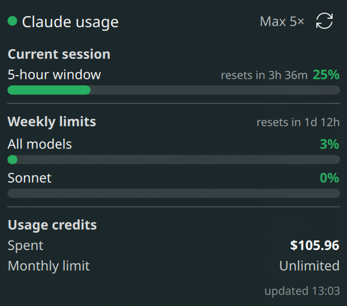

# Claude Meter (Plasma)

A KDE Plasma 6 panel/tray meter for your **Claude subscription usage limits** —
the same numbers Claude Code's `/usage` shows, always visible on your desktop.

The compact readout sits on your panel (e.g. `23%`, colour coded by
severity). Click it for a popup, open the full usage window for everything, and
get a desktop notification before you hit a limit.



## Features

- **Live limits** from `api.anthropic.com/api/oauth/usage`: current 5 hour
  session, this week, and any separate weekly limits (e.g. Fable), as real
  utilisation percentages.
- **Popup:** every limit with a reset countdown and a coloured progress bar.
- **Usage window:** a normal resizable window (popup expand button, middle click
  the panel readout, or right click > Open Usage Window) with everything: a
  weekly summary, reset times, pace projections ("at this pace, limit in 38m"),
  this week's usage by product (Claude Code, Chats, Cowork, Other), usage credits
  balance and state, and monthly spend (spent, limit, auto reload).
- **Configurable panel readout:** toggle which limits show while minimised
  (5h, this week, separate weekly limits).
- **Service health** from the public Claude status page
  (`status.claude.com/api/v2/summary.json`, no auth): a `!` badge in the popup
  header flashes yellow during elevated errors or degraded service and red
  during an outage, and a solid red `!` appears next to the panel percentage for
  an outage. Click the badge to open the status page. Severity only goes red for
  components the widget depends on (claude.ai, Claude Code, the API); anything
  else can only raise a yellow warning.
- **Threshold notifications** at 80% / 95% (configurable, fire once per window
  per reset cycle).
- **Refresh** every N seconds (default 60), on click, or via the popup's ↻ button.
- **Resilient:** caches the last good reading and shows it (dimmed) on a
  transient failure instead of blanking; backs off cleanly on rate limits.

## Requirements

- KDE Plasma 6 (developed on 6.6)
- Python 3 (standard library only — no pip installs)
- An active Claude subscription, signed in via **Claude Code** (the widget reads
  the OAuth token Claude Code stores in `~/.claude/.credentials.json` and never
  modifies it)
- `notify-send` for notifications (usually preinstalled on KDE)

## Install

```bash
git clone <this repo> ~/Documents/GitHub/claude-meter
cd ~/Documents/GitHub/claude-meter
./install.sh
```

`install.sh` symlinks `bin/claude-usage` into `~/.local/bin` and the plasmoid
into `~/.local/share/plasma/plasmoids`, so the repo stays the single source of
truth. Then add the widget: **right-click panel → Add Widgets → "Claude Usage"**.
If it doesn't appear, reload the shell:

```bash
kquitapp6 plasmashell && kstart plasmashell
```

## Layout

```
bin/claude-usage                         # Python CLI: fetch + normalize + notify
plasmoid/com.starrift.claudeusage/       # the Plasma 6 widget (QML)
  metadata.json
  contents/ui/main.qml                   # compact readout, popup, window
  contents/ui/UsageView.qml              # usage content shared by popup + window
  contents/ui/configGeneral.qml          # settings page
  contents/config/{main.xml,config.qml}  # config schema
install.sh                               # symlink into the install locations
```

## The CLI

`claude-usage` is usable on its own:

```bash
claude-usage --json                      # normalized JSON (what the widget reads)
claude-usage --line                      # e.g.  5h 23% · Week 3%
claude-usage --notify --thresholds 80,95 # also fire threshold notifications
claude-usage --no-status                 # skip the status page fetch
```

## Caveats

- **The `/api/oauth/usage` endpoint is unofficial.** A future Claude update could
  change its shape; the tool degrades to a status message rather than showing
  wrong data. See [`CLAUDE.md`](CLAUDE.md) for the response shape.
- The **daily routine run count** and **credits reset date** shown on claude.ai
  are web only data behind your browser session and are *not* available here.
- `extra_usage` values are in **USD cents** (`10596` = `$105.96`).
- The status page is a **Statuspage** feed; its severity vocabulary is
  interpreted, not official. In practice an "elevated errors" event ships as an
  incident with impact `major` while every component still reads `operational`,
  so incidents drive the yellow warning and component status drives red.
- The OAuth token is refreshed by Claude Code itself. If it expires (you haven't
  run `claude` in a while), the widget shows an "auth" hint — run `claude` once.

## License

[MIT](LICENSE)
